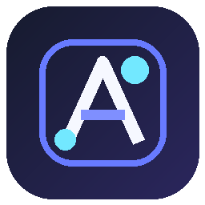

  

<h1 align="center">Agent Code 2.3.0</h1>

  <strong>Your AI coding agent. Your tools. Your environment.</strong>
   
  An open-source, customizable AI coding agent for desktop, terminal, and browser-based workflows.

  
  
  
  

  <a href="https://github.com/Agent-code-dev/Agent-code">GitHub</a> ·
  <a href="https://pypi.org/project/agent-code/">PyPI</a> ·
  <a href="https://agent-code-dev.github.io">Website</a>

---

What is Agent Code?

Agent Code is an open-source AI coding agent built around customization.

It gives you an AI-powered development workspace where you choose your AI provider, models, tools, extensions, and execution environments.

Unlike a fixed collection of tools, Agent Code provides three independent extension systems:

- Skills — Extend the AI agent with tools and specialized capabilities.
- Add-ons — Extend the Agent Code application itself.
- MCP — Connect external tools through the Model Context Protocol.

Use Agent Code through its desktop application, terminal interfaces, or authenticated WebUI server.

Features

Area| Capabilities
AI Agent| Tool calling, multi-step tasks, planning, implementation, debugging
Desktop| CustomTkinter interface, project navigation, settings, Markdown rendering
Terminal| Textual TUI and legacy curses interface
WebUI| Password-protected browser interface
Providers| OpenAI-compatible providers and custom endpoints
Skills| Native Python Skills and Claude-compatible "SKILL.md" instructions
Add-ons| Application UI contributions, actions, hooks, and integrations
MCP| External tool-server integration
Execution| Local machine, Podman container, and SSH remote execution
Project context| ".gitignore", ".agentignore", task history, checkpoints, and diffs
Diagnostics| Environment checks and diagnostic reports

Installation

Requirements: Python 3.10 or later.

Install from PyPI:

python -m pip install agent-code

Launch the desktop application:

agent-code

Launch the terminal interface:

agent-code tui

Launch the authenticated browser interface:

agent-code server

Upgrade:

python -m pip install --upgrade agent-code

Headless installation

For machines without a graphical desktop, use the lightweight installation:

python -m pip install "agent-code[lite]"
agent-code server

You can also use "agent-code tui" for terminal-based development.

See the "installation guide" (docs/installation.md).

Interfaces

Interface| Command| Description
Desktop| "agent-code"| CustomTkinter graphical workspace
Desktop explicitly| "agent-code gui"| Launch the GUI
Textual TUI| "agent-code tui"| Full terminal workspace
Legacy TUI| "agent-code tui-legacy"| Classic curses interface
WebUI| "agent-code server"| Authenticated browser-based workspace

Agent Code Server

The server runs the Agent Code workspace through a password-protected website. It supports headless environments and does not require a local desktop display.

Start the server:

agent-code server

The first startup generates a one-time password and prints it in the startup output.

Set a username and password:

agent-code server --username myuser --set-password

Choose a port:

agent-code server --port 9000

Open the URL printed by the server.

Security: Do not expose the plain HTTP listener directly to the public internet. Use a VPN or HTTPS reverse proxy.

See "Server Mode" (docs/server-mode.md).

AI Providers

Agent Code uses an OpenAI-compatible client architecture.

Provider presets include:

Provider| Endpoint
OpenAI| "https://api.openai.com/v1"
Google AI Studio| "https://generativelanguage.googleapis.com/v1beta/openai/"
Anthropic compatibility endpoint| "https://api.anthropic.com/v1/"
OpenRouter| Provider preset
Custom| User-configured OpenAI-compatible endpoint

Compatibility depends on the provider, model, and supported API features. The Anthropic entry uses an OpenAI SDK compatibility interface; it does not guarantee support for every native Anthropic API feature.

Bring Your Own Key

Agent Code follows a BYOK model:

- Choose your own provider.
- Choose your own model.
- Supply your own API credentials.
- Control your provider usage and spending.

External providers may charge for API usage or impose their own limits.

Credential security

Newly saved API keys are stored through Python "keyring" in the operating system's credential store where supported.

Examples include:

- Windows Credential Manager
- macOS Keychain
- Linux Secret Service-compatible keyrings

Configuration files store credential references rather than newly saved API-key values. If secure credential storage is unavailable, saving credentials fails rather than silently writing new secrets as plaintext.

Three Extension Systems

1. Skills — Extend the AI Agent

Skills add tools and specialized capabilities to the agent.

A native Skill can provide:

- Python functions.
- AI-callable tool schemas.
- Agent commands and aliases.
- Metadata and help documentation.

Example structure:

my_skill/
├── skill.py
└── skill.md

Supported exports include:

Export| Purpose
"SKILL"| Skill metadata
"TOOL_SCHEMAS"| AI tool definitions
"TOOL_CALLABLES"| Python implementations
"COMMANDS"| Optional commands and aliases
"HELP"| Optional help text

Install and list bundled Skills:

agent-code skills install
agent-code skills list

Agent Code also supports instruction-only Claude-compatible "SKILL.md" files from supported locations. These are loaded as instructions rather than executed as Python modules.

See "Claude-compatible Skills" (docs/claude-skills.md).

2. Add-ons — Extend the Application

Add-ons extend supported parts of the Agent Code application rather than only adding agent tools.

Depending on the available extension points, they can provide:

- UI components.
- Sidebar and toolbar contributions.
- Application actions.
- Settings extensions.
- Agent tools and commands.
- Lifecycle hooks.
- Service integrations.

Example structure:

my-addon/
├── addon.json
└── addon.py

Security: Add-ons are executable Python code. They are not sandboxed and run with the permissions of the Agent Code process. Install only trusted Add-ons.

See "Add-on Development" (ADDON-DEVELOPMENT.md).

3. MCP — Connect External Tools

Agent Code supports Model Context Protocol integration.

MCP allows the agent to connect to external tool servers and use the capabilities they expose.

MCP is managed separately from native Skills and application Add-ons.

Only connect trusted MCP servers and review the resources and operations they expose.

Agent Modes and Permissions

Agent Code separates task workflow from operation permissions.

Plan Mode

- Analyze an existing project.
- Understand requirements.
- Identify relevant files.
- Prepare an implementation plan.

Build Mode

- Implement requested changes.
- Create and modify files.
- Execute supported commands.
- Investigate errors.
- Review task results.

Core Mode

A lightweight configuration focused on essential capabilities and a reduced tool surface.

Permission modes

Agent Code provides configurable permission behavior, including:

- Read-only operation.
- Ask-before-operation behavior.
- Automatic approval for operations covered by the configured policy.

Permission settings do not bypass operating-system permissions or remote-host restrictions.

Execution Environments

Local Execution

Supported operations can execute directly on the host machine when sandboxing is disabled.

Local execution is subject to the configured permission policy and operating-system permissions. It is not a strong security boundary.

Podman Sandbox

Agent Code supports an optional Podman-based Linux sandbox.

The project workspace is mounted inside the container at:

/workspace

The Alpine Linux configuration provides common development tools and package management.

Install additional Alpine packages with:

apk add --no-cache package-name

The sandbox applies restrictions such as dropped capabilities and "no-new-privileges".

The project workspace remains shared with the host, so changes made inside the container also affect host project files. Containerization is not a guarantee against every malicious or destructive operation.

See "Podman Container Selection" (docs/podman-container-selection.md).

SSH Remote Execution

Connect to authorized remote development machines using supported SSH authentication methods.

The integration supports SSH configuration, keys, agents, and password authentication.

Remote commands execute on the remote machine and are subject to its permissions.

Verify unknown host fingerprints before accepting them.

Project Context

Agent Code uses project ignore rules when building its bounded project context.

It reads:

- ".gitignore"
- ".agentignore"

Example ".agentignore":

node_modules/
dist/
build/
coverage/
*.min.js
*.map

Hard safety exclusions, including environment files and credential-related files, cannot be overridden by ignore negation patterns.

Project Validation

The validation helper can recognize common test entry points for Python, Rust, Go, and Node projects.

It does not install project dependencies or configure build systems.

Node package-manager scripts can execute arbitrary project commands and may require explicit approval.

Browser Automation

Agent Code includes browser automation capabilities through its browser integration.

Available operations depend on the installed browser and automation backend.

Run diagnostics if browser detection or setup fails:

agent-code doctor

Getting Started

1. Install Agent Code.
2. Launch the desktop or terminal interface.
3. Open Settings.
4. Configure your AI provider and API key.
5. Select a supported model.
6. Choose your project directory.
7. Send a test prompt.

Diagnostics

Check your environment:

agent-code doctor

Print machine-readable diagnostics:

agent-code doctor --json

Save a report:

agent-code doctor --output report.json

The diagnostics report is designed not to include API keys. Review reports before sharing them.

Command Reference

Command| Description
"agent-code"| Launch the default interface
"agent-code gui"| Launch the desktop GUI
"agent-code tui"| Launch the Textual TUI
"agent-code tui-legacy"| Launch the legacy curses interface
"agent-code configure"| Open the interactive settings center
"agent-code server"| Start the WebUI server
"agent-code doctor"| Check the environment
"agent-code doctor --json"| Print diagnostics as JSON
"agent-code --help"| Display command help

Example in-chat commands include:

- "/reset"
- "/history"
- "/skills"
- "/save"
- "/open <file>"

Available commands can depend on loaded Skills and Add-ons.

Configuration and Data Locations

Data| Linux / macOS| Windows
Configuration| "~/.config/agent-code/"| "%APPDATA%\agent-code\"
Skills| "~/.local/share/agent-code/skills/"| "%LOCALAPPDATA%\AgentCode\skills\"
Add-ons| "~/.local/share/agent-code/addons/"| "%LOCALAPPDATA%\AgentCode\addons\"
Workspace| Project-local "workspace/"| Project-local "workspace/"
Chats| Project-local "chats/"| Project-local "chats/"

Linux paths respect the relevant XDG environment variables.

Development

Clone the repository:

git clone https://github.com/Agent-code-dev/Agent-code.git
cd Agent-code

Install the project:

python -m pip install -e .
python -m pip install pytest

Run tests:

python -m pytest -q

Build distribution packages:

python -m pip install build
python -m build

The project uses a "src/"-based Python package layout.

Documentation

- "Installation" (docs/installation.md)
- "Server Mode" (docs/server-mode.md)
- "Podman Container Selection" (docs/podman-container-selection.md)
- "Claude-compatible Skills" (docs/claude-skills.md)
- "Add-on Development" (ADDON-DEVELOPMENT.md)
- "Server Documentation" (server/README.md)
- "Agent Code 2.3.0 Release Notes" (RELEASE_NOTES_2.3.0.md)

Security

Agent Code can execute commands and load executable extensions. Use it with projects, tools, and integrations you trust.

- Review commands before approving them.
- Treat local execution as host-level access, not as a sandbox.
- Remember that the Podman workspace is shared with the host.
- Review Skills and Add-ons before installing them.
- Connect only trusted MCP servers and remote machines.
- Protect API keys and SSH credentials.
- Inspect diffs before accepting changes.
- Treat repository files, terminal output, and web content as untrusted input.

License

Agent Code uses separate licenses for the application and standalone server.

Component| License
Agent Code application| MIT
Standalone registry server ("server/")| AGPL-3.0-only

See ""LICENSE"" (LICENSE) and ""server/LICENSE"" (server/LICENSE).
