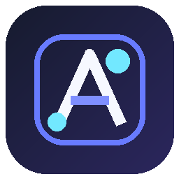

  

<h1 align="center">Agent Code 2.0</h1><h3 align="center">⚡ Your AI coding agent. Your tools. Your environment.</h3>

  An open-source, extensible AI coding agent built with Python and CustomTkinter.
   
  Build, modify, debug, and manage projects using AI — with customizable Skills, application Add-ons, and MCP integrations.

  
  
  
  

  
  
  

  <b>Windows · Linux · macOS</b>
   
  Python 3.10+ · OpenAI-compatible AI providers · Extensible architecture

---

🌟 What is Agent Code?

Agent Code is an open-source desktop AI coding agent designed to make AI-assisted software development more extensible and customizable.

It combines an AI-powered development workspace with a flexible tool architecture, allowing developers to expand both the capabilities of the AI agent and the application itself.

Instead of locking users into one provider or one fixed collection of tools, Agent Code gives developers control over their AI models, integrations, execution environments, and extensions.

🚀 The idea behind Agent Code

- 🤖 Use different AI providers with your own API keys.
- 🧩 Give the AI additional capabilities through native Python Skills.
- 🔌 Extend the desktop application through Add-ons.
- 🌐 Connect external tools through MCP.
- 💻 Work with local projects and development environments.
- 📦 Use an optional Alpine Linux sandbox.
- 🖥️ Connect to remote development machines through SSH.
- ⚙️ Customize agent workflows and execution permissions.

One application. Multiple extension systems. Your choice of AI provider.

---

✨ Features

<table>
  <tr>
    <td width="50%" valign="top">🤖 AI Coding Agent

- Tool-calling architecture

- Multi-step task execution

- Project-aware workflows

- Plan Mode and Build Mode

- Error investigation

- Task completion summaries

- File change and diff review

- Checkpoints and recovery
  
    </td>
  <td width="50%" valign="top">

🎨 Desktop Workspace

- CustomTkinter interface

- Chat-based development

- Markdown responses

- Project navigation

- Model selection

- Provider configuration

- Activity Details panel

- Integrated Skills management
  
    </td>
</tr>
<tr>
  <td width="50%" valign="top">

🧩 Extension Architecture

- Native Python Skills

- Application Add-ons

- MCP integration

- Custom agent tools

- Namespaced commands

- Application lifecycle hooks

- Supported UI extensions

- Service integrations
  
    </td>
  <td width="50%" valign="top">

🖥️ Execution Environments

- Local execution

- Alpine Linux sandbox

- SSH remote execution

- Browser automation

- Configurable permissions

- Project workspace isolation

- Multiple execution targets
  
    </td>
</tr>

</table>---

🧠 Three Independent Extension Systems

Agent Code 2.0 has three distinct extension systems.

They are designed for different purposes and can coexist.

System| Purpose| Extension type
🧩 Skills| Extend what the AI agent can do| Native Python
🔌 Add-ons| Extend Agent Code itself| Application extensions
🌐 MCP| Connect external tools| MCP protocol

🧩 1. Skills — Extend the AI Agent

Skills give the AI agent additional tools and specialized capabilities.

A Skill can provide:

- Python functions.
- AI-callable tool schemas.
- Agent-specific commands.
- Natural-language command aliases.
- Skill metadata.
- Help documentation.

Example Skill structure

skills/
└── my_skill/
    ├── skill.py
    └── skill.md

Example implementation

SKILL = {
    "name": "my_skill",
    "description": "An example Agent Code skill."
}

def greet(name: str = "world") -> str:
    return f"Hello, {name}!"

TOOL_SCHEMAS = [
    {
        "type": "function",
        "function": {
            "name": "greet",
            "description": "Return a greeting.",
            "parameters": {
                "type": "object",
                "properties": {
                    "name": {"type": "string"}
                },
                "required": []
            }
        }
    }
]

TOOL_CALLABLES = {
    "greet": greet
}

The native loader reads:

Export| Purpose
"SKILL"| Skill metadata
"TOOL_SCHEMAS"| AI tool definitions
"TOOL_CALLABLES"| Python implementations
"COMMANDS"| Optional commands and aliases
"HELP"| Optional help text

Skills can be reloaded without restarting Agent Code. When an agent task is running, tool reloads are deferred until the task finishes.

Bundled Skills

Agent Code 2.0 includes:

Skill| Description
📁 "filesystem"| File operations within the workspace
🌐 "public_api"| Search and use public APIs
📧 "temp_mail"| Temporary inbox and supported email integrations

Install bundled Skills:

agent-code skills install

List bundled Skills:

agent-code skills list

Developer documentation: "Build a Skill" (docs/skills.html)

---

🔌 2. Add-ons — Extend Agent Code Itself

Skills extend the AI agent.

Add-ons extend the application.

This is one of the central architectural differences in Agent Code 2.0.

Add-ons are designed to let developers customize supported parts of the application, rather than being limited to adding AI tools.

Add-on capabilities

- Custom application UI.
- Sidebar contributions.
- Additional application actions.
- Workspace extensions.
- Settings extensions.
- Toolbar contributions.
- Agent tools and commands.
- Lifecycle hooks.
- Supported service replacements.

Example structure

my-addon/
├── addon.json
└── addon.py

Example manifest

{
    "name": "my-addon",
    "version": "1.0.0",
    "description": "An example Agent Code extension",
    "author": "Developer"
}

Example Add-on

def build_sidebar_button(parent, app):
    import customtkinter as ctk

    return ctk.CTkButton(
        parent,
        text="My Workspace",
        command=lambda: app.log_line(
            "Workspace opened",
            "dim"
        )
    )

def register(api):
    api.register_ui(
        "my-workspace",
        build_sidebar_button,
        location="sidebar",
        label="My Workspace"
    )

    api.register_action(
        "Sample action",
        lambda: "Action completed"
    )

Supported UI locations

Location| Purpose
"sidebar"| Sidebar components
"addons"| Add-ons page
"settings"| Settings contributions
"toolbar"| Toolbar components
"workspace"| Workspace components

Add-ons can also register named service implementations where the relevant Core integration exposes a service extension point.

They use the supported Add-on API rather than unrestricted monkey-patching of application internals.

Security: Add-ons are trusted Python code and execute with the user's operating-system permissions. They are not sandboxed.

Developer documentation: "Add-on Development" (ADDON-DEVELOPMENT.md)

---

🌐 3. MCP — Connect External Tools

Agent Code supports Model Context Protocol integration.

MCP allows the AI agent to connect to external tool servers and use capabilities exposed by those servers.

This provides another way to extend the agent without implementing every external integration as a native Skill.

MCP is managed separately from native Skills and application Add-ons.

Skills, Add-ons, and MCP are independent systems.

---

⚙️ Agent Modes and Permissions

Agent Code separates the way an agent approaches a task from the permissions granted to its operations.

📋 Plan Mode

Plan Mode focuses on understanding a task before implementation.

Useful for:

- Analyzing an existing project.
- Understanding requirements.
- Identifying files that may need changes.
- Preparing implementation steps.
- Reviewing an approach before building.

🛠️ Build Mode

Build Mode focuses on implementing the requested work.

The agent can use its available tools to:

- Create files.
- Modify source code.
- Execute supported commands.
- Investigate errors.
- Implement planned changes.
- Review task results.

⚡ Core Mode

Core Mode provides a lightweight agent configuration with a reduced tool surface.

It focuses on essential capabilities such as file creation, shell execution, and CURL operations.

Skills and Add-ons behavior follows the application's Core Mode policy.

🔐 Permission behavior

Agent Code provides configurable permission behavior.

Mode| Purpose
🛡️ Safe| Restrict potentially sensitive operations
⚙️ Normal| Balanced execution permissions
⚡ Auto| Automatically allow operations covered by the configured policy
👁️ Read-only| Restrict operations that modify files or execute commands

Automatic permission does not override remote-host restrictions, operating-system permissions, or unavailable execution environments.

---

🖥️ Execution Environments

Agent Code separates tool capabilities from their execution environment.

💻 Local Execution

Run supported operations on the host computer.

Useful for:

- Local development tools.
- Project files.
- Installed software.
- Local configuration.
- Browser access.

When the optional sandbox is disabled, shell commands execute on the host OS.

📦 Alpine Linux Sandbox

Agent Code supports an optional Podman-based Linux sandbox.

The sandbox uses:

Alpine Linux 3.22

It provides:

- Bash.
- Core Linux utilities.
- Git.
- CURL.
- Python and pip.
- GCC and G++ through Alpine build packages.
- Alpine package management.

Install additional packages inside the container using:

apk add --no-cache package-name

The project workspace is mounted into the container at:

/workspace

The sandbox uses a separate container environment, dropped capabilities, and "no-new-privileges".

However, the project workspace remains shared with the host. Containerization is not a guarantee against every form of malicious or destructive operation.

🌐 SSH Remote Execution

Connect Agent Code to remote development machines.

The SSH integration supports:

- Hostname or IP.
- SSH username.
- Custom port.
- Private-key path.
- SSH agent.
- OpenSSH configuration.
- Password authentication.

Remote commands are subject to the configured permission policy.

Unknown SSH host keys are not silently trusted. Verify the host fingerprint before accepting it.

Install the optional SSH dependency if required:

python -m pip install paramiko

Only connect to machines you are authorized to administer.

---

🌍 Browser Automation

Agent Code includes browser automation capabilities through its browser integration.

Browser tools can support workflows involving:

- Opening websites.
- Navigating pages.
- Interacting with web interfaces.
- Inspecting page content.
- Browser diagnostics.

A supported Chromium-based browser must be installed on the machine where browser automation runs.

Firefox and Chromium browser detection is included in the diagnostic workflow, but browser compatibility depends on the automation backend and installed browser components.

If automatic browser detection fails, check the browser executable configuration.

Run:

agent-code doctor

---

🤖 AI Providers and Models

Agent Code uses an OpenAI-compatible client architecture.

You can configure supported providers through the application's API and model settings.

Supported provider presets

Provider| Endpoint
OpenAI| "https://api.openai.com/v1"
Google AI Studio| "https://generativelanguage.googleapis.com/v1beta/openai/"
Anthropic| "https://api.anthropic.com/v1/"
OpenRouter| Provider preset
Custom| User-configured OpenAI-compatible endpoint

Provider compatibility depends on supported API features, model identifiers, and request formats.

The Anthropic compatibility endpoint uses the OpenAI SDK compatibility surface. Some native Claude API features may not be available through that interface.

🔑 Bring Your Own Key

Agent Code is designed around BYOK.

You control:

- Your AI provider.
- Your API credentials.
- Your selected model.
- Your API usage.
- Your provider spending.

There is no mandatory recurring AI subscription built into the application.

External providers may charge for their APIs or impose their own account requirements.

🔒 Credential storage

Provider credentials are stored through Python "keyring" in the operating system's credential store where supported.

Examples include:

- Windows Credential Manager.
- macOS Keychain.
- Linux Secret Service-compatible keyrings.

The JSON configuration stores credential references rather than newly saved API-key values.

If the operating-system credential store is unavailable, saving credentials fails rather than silently writing new secrets in plaintext.

---

🎨 Desktop Experience

Agent Code uses Python and CustomTkinter for its desktop interface.

The interface is organized around the development workspace.

Workspace features

- Chat-based interaction.
- Project navigation.
- Skills management.
- Add-ons management.
- MCP configuration.
- API and model settings.
- Help and documentation.
- Task status and activity information.

Activity Details

Agent Code separates the main conversation from internal task activity.

Activity Details OFF

The chat remains focused on user messages and assistant responses.

During a task, the compact status is:

"Working in project"

Internal settings, model events, checkpoints, and detailed task events stay outside the main conversation.

Activity Details ON

The activity panel provides access to detailed task and tool events, including completion information and recovery details.

Task stopping

Agent Code supports cooperative stop controls and a three-click force-stop gesture.

The force-stop behavior requests stronger cancellation of the agent's work and further AI/tool communication.

It is not designed to close the browser application.

Some blocking network calls or operations may only stop when their timeout or current operation returns.

Recovery and review

Task completion reports can include:

- Changed files.
- Text additions and deletions where safely measurable.
- Binary file identification.
- Diff review.
- Recovery information.

Review file changes and restore conflicts before applying recovery actions.

---

📥 Installation

Requirements

- Python 3.10 or newer.
- Tkinter.
- CustomTkinter.
- Internet access for remote AI providers.
- A compatible browser for browser automation.

Optional features require their respective dependencies.

Install from PyPI

The recommended installation method:

python -m pip install --upgrade pip
python -m pip install agent-code

Upgrade:

python -m pip install --upgrade agent-code

Ubuntu / Debian

Install the required system components:

sudo apt update

sudo apt install \
    python3 \
    python3-venv \
    python3-tk \
    chromium \
    podman

Podman is optional unless you want the Linux sandbox.

Create a virtual environment:

python3 -m venv .venv

source .venv/bin/activate

python -m pip install --upgrade pip

python -m pip install agent-code

Windows

Install Python 3.10 or newer with Tcl/Tk support.

Install a compatible Chromium-based browser for browser automation.

Then:

python -m pip install agent-code

macOS

Install Python 3.10 or newer with Tcl/Tk support.

Install a compatible Chromium-based browser.

Then:

python3 -m pip install agent-code

Install from source

git clone https://github.com/agent-code-dev/agent-code.git

cd agent-code

python -m venv .venv

source .venv/bin/activate

python -m pip install --upgrade pip

python -m pip install .

On Windows, activate the virtual environment using:

.venv\Scripts\activate

---

🚀 Getting Started

Launch the desktop application

agent-code

Explicitly launch the GUI

agent-code gui

Launch the terminal interface

agent-code tui

The TUI is useful for headless Linux environments and SSH sessions.

On Linux, Agent Code can automatically select the TUI when no graphical display is available.

Check your installation

agent-code doctor

Generate machine-readable diagnostics:

agent-code doctor --json

Save a diagnostics report:

agent-code doctor --output report.json

The diagnostics report does not include API keys.

Get command help

agent-code --help

---

⚙️ First-Time Configuration

1. Launch Agent Code.
2. Open Settings.
3. Navigate to the API and model settings.
4. Select a provider.
5. Enter your API key.
6. Select a supported model.
7. Save the configuration.
8. Send a small test prompt.

Choose the project directory you want Agent Code to work in.

Project workspace files and chat data are associated with the active project, while Skills and Add-ons use per-user locations.

---

📁 Configuration and Data Locations

Agent Code uses platform-specific directories for user configuration and extensions.

Data| Linux / macOS| Windows
Configuration| "~/.config/agent-code/"| "%APPDATA%\agent-code\"
Skills| "~/.local/share/agent-code/skills/"| "%LOCALAPPDATA%\AgentCode\skills\"
Add-ons| "~/.local/share/agent-code/addons/"| "%LOCALAPPDATA%\AgentCode\addons\"
Project workspace| "./workspace/"| "./workspace/"
Project chats| "./chats/"| "./chats/"

The Linux directories respect the corresponding XDG environment variables.

Legacy project-local Skills can be migrated into the global Skills directory. Existing global Skills are not overwritten during migration.

---

🧰 Command Reference

Application commands

Command| Description
"agent-code"| Launch the application
"agent-code gui"| Explicitly launch the desktop GUI
"agent-code tui"| Launch the terminal interface
"agent-code doctor"| Check the local environment
"agent-code doctor --json"| Print diagnostic information as JSON
"agent-code doctor --output report.json"| Save a diagnostic report
"agent-code --help"| Display available commands

Skills commands

Command| Description
"agent-code skills list"| List bundled Skills
"agent-code skills install"| Install bundled Skills into the user/project environment

In-chat commands

The agent also supports built-in and extension-provided commands.

Examples include:

Command| Purpose
"/reset"| Reset conversation memory
"/history"| Display recent messages
"/skills"| Inspect loaded Skills and commands
"/save"| Save the conversation
"/open <file>"| Open a workspace file

Skills can register additional commands.

Add-on commands are namespaced, for example:

/sample-addon:status

---

🔐 Security

Agent Code is an AI development tool that can execute commands and load extensions. Its security depends on the selected execution environment and the code you choose to trust.

Local shell

When Podman sandboxing is disabled:

- Commands execute on the host operating system.
- Shell operators and known high-risk command patterns are restricted.
- Workspace boundaries are enforced where detectable.
- It is not a strong security boundary.

Podman sandbox

When enabled:

- Shell and background commands run in Alpine Linux 3.22.
- The project workspace is mounted into the container.
- Container capabilities are dropped.
- "no-new-privileges" is enabled.
- Outbound networking depends on Podman and host network configuration.

The sandbox runs as root inside the container, not as host root.

The workspace remains shared with the host, so commands can still change or delete project files.

Extension security

Component| Security consideration
Skills| Arbitrary Python code
Add-ons| Trusted Python code with user permissions
MCP| External tools may access exposed resources
Local shell| Executes on the host when sandboxing is disabled
SSH| Executes commands on the connected remote machine

Security recommendations

- Review Skills before installing them.
- Only install Add-ons from trusted developers.
- Connect only trusted MCP servers.
- Protect API credentials.
- Keep SSH private keys secure.
- Review commands before granting automatic permissions.
- Inspect file diffs before accepting changes.
- Treat web pages and repository content as untrusted input.

---

🛠️ Development

Clone the repository:

git clone https://github.com/agent-code-dev/agent-code.git

cd agent-code

Create a development environment:

python -m venv .venv

source .venv/bin/activate

Install the project:

python -m pip install --upgrade pip

python -m pip install -e .

Run tests:

python -m pytest -q

Build distribution packages:

python -m pip install build

python -m build

The project uses a "src/"-based Python package structure.

---

📚 Documentation

The repository includes offline-friendly HTML documentation.

Documentation| Description
📖 "User Guide" (docs/index.html)| Installation, configuration, workflows, permissions, browser, SSH and troubleshooting
🧩 "Skills Guide" (docs/skills.html)| Skill structure, tool schemas, commands and development
🔌 "Add-on Guide" (docs/addons.html)| Application extension API, UI contributions, actions, hooks and services
📋 "Release Notes" (RELEASE-NOTES-2.0.0.md)| Agent Code 2.0.0 changes
🖥️ "Server Documentation" (server/README.md)| Separate Skills registry backend

---

🗂️ Project Structure

Agent-code/
│
├── src/
│   └── agent_code/
│       ├── __init__.py
│       ├── __main__.py
│       ├── agent.py
│       ├── loader.py
│       ├── addons.py
│       ├── advanced_features.py
│       ├── mcp_manager.py
│       ├── paths.py
│       ├── projects.py
│       ├── skill_manager.py
│       ├── doctor.py
│       ├── cli.py
│       ├── tui.py
│       │
│       └── data/
│           ├── icons/
│           └── skills/
│
├── docs/
│   ├── index.html
│   ├── skills.html
│   └── addons.html
│
├── server/
│   ├── skill-server.py
│   ├── README.md
│   └── LICENSE
│
├── tests/
│
├── ADDON-DEVELOPMENT.md
├── RELEASE-NOTES-2.0.0.md
├── README.md
├── LICENSE
├── MANIFEST.in
└── pyproject.toml

---

🗺️ Roadmap

Areas of continued development:

- 🚀 Improve agent reliability and task execution.
- 🧠 Reduce unnecessary AI context and token consumption.
- 🧩 Expand the Skills ecosystem.
- 🔌 Expand supported Add-on extension points.
- 🌐 Improve MCP integration.
- 📦 Improve sandbox reliability.
- 🖥️ Improve cross-platform compatibility.
- 🔐 Strengthen extension security.
- 🎨 Improve the desktop experience.
- ⚙️ Improve provider compatibility and configuration.

---

🤝 Contributing

Contributions are welcome!

You can help Agent Code by:

- Reporting bugs.
- Suggesting features.
- Improving documentation.
- Creating Skills.
- Developing Add-ons.
- Testing compatibility.
- Reviewing architecture.
- Submitting pull requests.

For significant changes, open an issue before starting implementation so the proposed direction can be discussed.

Repository: "agent-code-dev/agent-code" (https://github.com/agent-code-dev/agent-code)

---

📜 License

Agent Code uses separate licenses for its application and standalone server.

Component| License
Agent Code application| MIT
Standalone registry backend ("server/")| AGPL-3.0-only

The server's AGPL license does not replace the application's MIT license.

See:

- "Application LICENSE" (LICENSE)
- "Server LICENSE" (server/LICENSE)

---

  

<h2 align="center">⚡ Agent Code 2.0</h2>

  <b>Your AI coding agent. Your tools. Your environment.</b>
    
  <a href="https://github.com/agent-code-dev/agent-code">GitHub</a>
  ·
  <a href="https://pypi.org/project/agent-code/">PyPI</a>
  ·
  <a href="https://agent-code.page.gd">Website</a>

  Built with Python · Designed for extensibility

